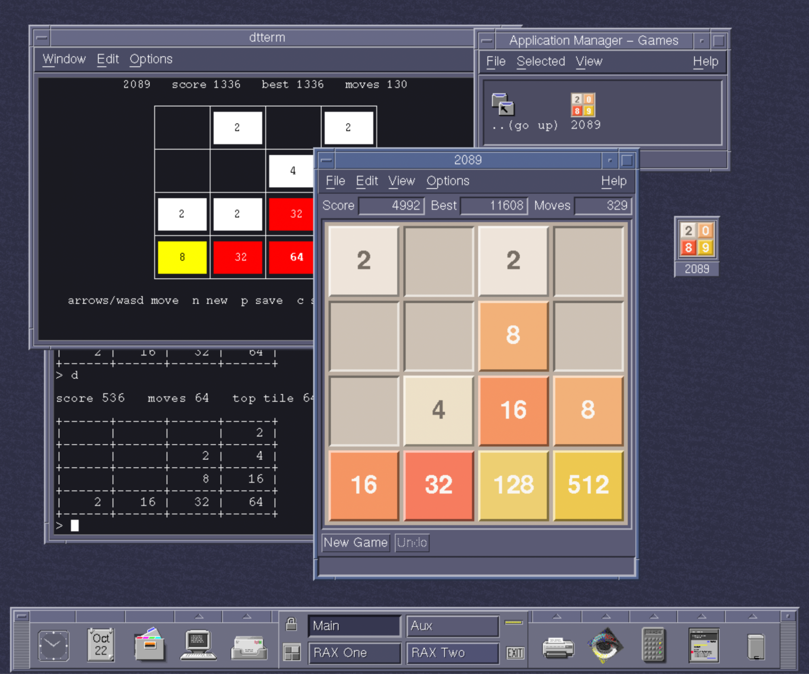

2089: An industry-standard implementation of 2048
---------------------------------------------------------------------------



Gabriele Cirulli's [2048](https://github.com/gabrielecirulli/2048) is a famously addictive, simple game with many adaptations and ports across different platforms. **2089** is yet another one of these projects, but unlike most others, the goal from the start is to run on _anything_. 2089's modular architecture supports all kinds of potential "frontends" to a shared core engine, from line-mode terminal adaptations running on hardcopy teletypes to server-side CGI interfaces, all written in standard C89 for maximum portability.

## Bundled frontends
- VT52+ `curses` TUI with up to 256-color support
- Universal line-mode TUI for dumb/unsupported terminals and teletypes
- Basic mono/color X11 GUI
- Mono/color X11/Motif 2.x GUI with optional CDE integration

Testing for TUI clients performed on both Linux and AIX 4.3 with Ericom Powerterm 525 clients, X11 clients thus far tested on AIX 4.3 only.

## Build requirements

- A C89 compiler
- Optional but recommended: POSIX (or GNU) `make`

## Building

On Unix-like systems:

```sh
make                # the text frontend and the tests, plus the full program
                    # (frontend/curses/2089) if a curses library can be found
make text           # the text frontend and the tests only
make run            # build, then play (make run ARGS="-u -s 5" passes options)
make check          # run the tests
```

`make install` copies the program to `/usr/local/bin` (the full program if it was
built, else the text frontend), with `x2089` and `xm2089` too if `make x11` built
them, and their manual pages, `2089(6)`, `x2089(6)` and `xm2089(6)`, to
`/usr/local/man/man6`. Name another place with `PREFIX`, such as your own `bin`:

```sh
make x11 install PREFIX=$HOME       # ~/bin/2089 ... and ~/man/man6/2089.6 ...
```

The pages are plain `-man` source, which `man` formats itself. AIX's `man` looks only
in `/usr/share/man` and `/usr/dt/man` unless told otherwise: put
`MANPATH=/usr/local/man:/usr/share/man:/usr/dt/man` in `/etc/environment` or your
profile, or try one with `man -M /usr/local/man 2089`.

`make` uses `cc` by default; name another compiler with `CC`:

```sh
make CC=c89
```

Without `make`, compile the core (`2089.c`, `rng89.c`) with the program
(`frontend/main.c`, `frontend/common.c`) and line mode (`frontend/text/text.c`), telling
the compiler where the headers are; for the full program, add `-DT89_CURSES`,
`frontend/curses/curses.c` and the curses library:

```sh
cc -I. -Ifrontend -o 2089 frontend/main.c frontend/text/text.c frontend/common.c 2089.c rng89.c
cc -I. -Ifrontend -DT89_CURSES -o 2089 frontend/main.c frontend/text/text.c \
    frontend/curses/curses.c frontend/common.c 2089.c rng89.c -lcurses
```

The core needs no C library at all, so it builds for freestanding targets too. The text
frontend needs only the standard C89 library: it works on any terminal, from a teletype
up (`2089 -h` for options; `-k` gives a compact display for slow lines). The full
program plays full screen through curses, and falls back to line mode by itself when
the terminal can't (a pipe, an unknown or hardcopy terminal, a screen too small for the
board) or when asked with `-t`. It needs an X/Open curses (SVR4 curses, ncurses, NetBSD curses,
PDCurses); if the library isn't found (`make` tries `-lcurses`, `-lncurses`, and those with `-ltinfo` or
`-ltermcap`), name it: `make CURSES='-L/opt/lib -lcurses'`.

Full screen, the best score for each board size is kept in `~/.2089`, as the save
string of the game that made it (so `2089 -l` brings it back). To keep it somewhere
else, build with `-DT89_SCORES='"/path/to/file"'`.

### X11

Two programs play in a window of their own under the X Window System, sharing the
board code in `frontend/x11`:

- `x2089` (`frontend/x11/xlib`) needs only Xlib (`-lX11`), so it builds wherever X11 does.
- `xm2089` (`frontend/x11/motif`) is a Motif-native application (Motif 2.0 or later)
  that runs on its own under any window manager and integrates with CDE where there
  is one (below). It's as compact as CDE's own tools: menus, the scores in sunken
  fields, tiles raised with Motif bevels, optional arrow buttons to play with the mouse
  (View > Arrow Buttons, or `-arrows`), a status line, and dialogs to start a new game
  (of another size, or by its number), open and save games as files, copy or paste save
  strings and see (or clear) the best score for each size. Under CDE its tiles can take
  the colors of the desktop palette, following Style Manager (`-colors desktop`); past
  2048, Options > Extended Colors (on unless `+extended`) can be turned off for the
  original's one dark color.

```sh
make x11                    # x2089, and xm2089 if Motif can be found
make xlib                   # or one at a time
make motif
make x11 X11INC=-I/usr/X11R6/include X11LIB="-L/usr/X11R6/lib -lX11" \
    MOTIFLIB="-L/usr/X11R6/lib -lXm -lXt -lX11"
```

or the X way, with the X installation's own `imake` rules (on AIX, with `/usr/vac/bin`
on `PATH`):

```sh
cd frontend/x11 && xmkmf -a && make         # both
cd frontend/x11/xlib && xmkmf && make       # x2089 alone, without Motif
```

Both take the usual X options (`-display`, `-geometry`; `x2089` also `-fn` for its text
font, `xm2089` everything Xt takes) and `-mono`, besides `-u`, `-s`, `-r` and `-l`. As
resources: `x2089.geometry`, `x2089.font`, `x2089.mono: true`; `XM2089*undo: true`,
`XM2089*colors: game`, `desktop` or `mono`, `XM2089*extended: false`, `XM2089*size: 5`;
`xm2089`'s Options > Save Options writes its settings to `~/.xm2089` (resources, over
those in `~/.Xdefaults`, under the command line). Windows can be resized. They play
in the original game's colors where the display has them (past 2048, greens as in the
later mobile versions, then blues and violets of our own), and in black and white
otherwise (`c` switches). The keys are the terminal frontends' (`?` lists them), the
best scores are kept in the same
`~/.2089`, and quitting prints the command that carries on the game.

#### On the CDE desktop

`make install-cde` puts `xm2089` on the CDE desktop as if it came with it: an action
and icons, so that 2089 is in Application Manager (in a Games group) and saved games
(`*.2089`) open from File Manager, and a help volume, built with CDE's `dthelptag`, for
Help > Overview. The game being played is saved with the session when you log out, and
comes back when you log in. For yourself (in `~/.dt`):

```sh
make x11 install install-cde PREFIX=$HOME
```

or for every user, as root: `make x11 install install-cde DTDIR=/etc/dt/appconfig DTLANG=/C`.
Then choose Reload Actions and Reload Applications in Application Manager's
Desktop_Tools, or log out and in again.

## Other C implementations of 2048

There's much prior art inspiring 2089, which is far from the first attempt to implement this game in C, though it is perhaps the first attempt at an explicitly "universal" implementation capable of supporting multiple platforms, interfaces and compilers. A few other projects include:

- [2048.c](https://github.com/mevdschee/2048.c): A C99 console implementation targeting Linux, that has also been successfully used as the basis for a [Palm OS](https://github.com/nizovn/2048.prc) version
- [2048-cli](https://github.com/tiehuis/2048-cli): Another Linux console implementation with both plain VT and ncurses frontends
- [libretro-2048](https://github.com/libretro/libretro-2048): A port of 2048 to [libretro](https://www.libretro.com/index.php/api/)

2089 uses no code from these projects, unless explicitly noted.
